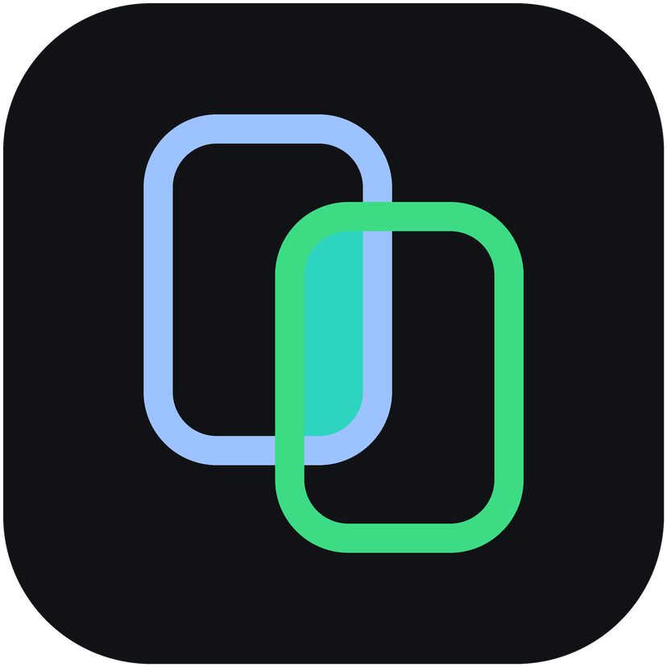
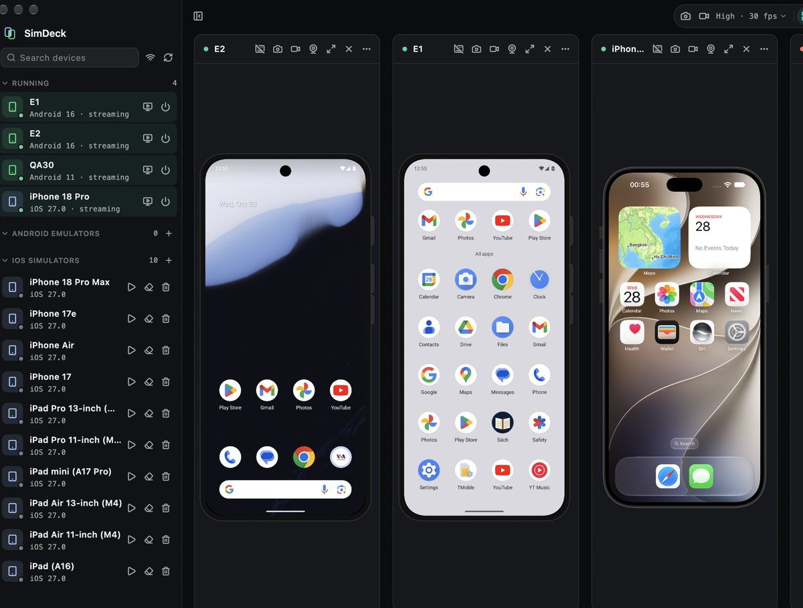
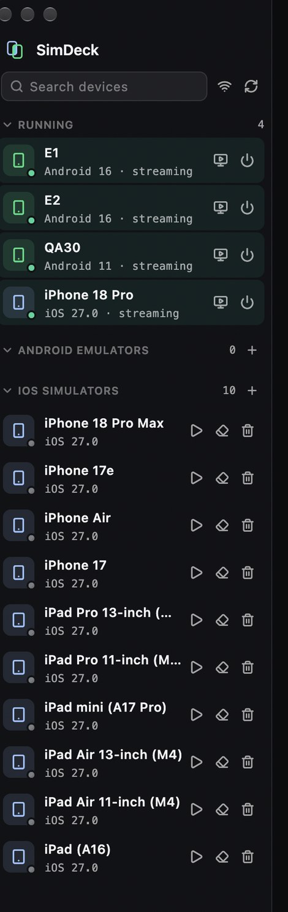

<p align="center">
  
</p>
<h1 align="center">SimDeck</h1>

<p align="center">
  <strong>Create, run, stream and delete Android emulators and iOS simulators, without Android Studio</strong><br>
  One macOS app for AVDs, system images, iOS runtimes, device screens, input and agent automation.
</p>

> **Where this comes from.** SimDeck is a **public fork** of two MIT projects, and it says so on purpose:
>
> - [**dungngminh/simutil**](https://github.com/dungngminh/simutil) — the Flutter app shell, streams, input, recording and MCP server. Forked at tag `app-v0.5.0`.
> - [**wasabeef/emu**](https://github.com/wasabeef/emu) — the Rust device manager (AVD create/edit, system images, iOS simulators), embedded as the `emu` JSON helper. Our patches live in the fork [**cuongdq88/emu**](https://github.com/cuongdq88/emu/tree/simdeck-json-cli), based on `v1.3.0`.
>
> What SimDeck adds on top: the Create/Edit device sheet, the helper JSON CLI, the deletion guard, the SDK Manager, first-run toolchain setup, the brew cask and the performance work. Both upstreams stay MIT-licensed — see [LICENSE](LICENSE) and [third_party/](third_party/).

## Screenshots



The sidebar puts what is **running** on top; emulator and simulator groups keep
their add button, and every shut-down row offers start, edit, wipe and delete:



## What it does

- **Create** an Android AVD from a hardware profile and an installed system
  image (API, tag, ABI, RAM, storage, camera, orientation, keyboard), or an iOS
  simulator from a device type and runtime.
- **Edit** a shut-down AVD: RAM, storage, camera, orientation, keyboard, SD
  card. The image identity (profile / API / tag / ABI) stays locked, like
  Android Studio; every other `config.ini` key is preserved byte for byte and
  the file is written atomically.
- **SDK Manager**: installed and downloadable system images grouped by API,
  install/uninstall with progress, SDK licence acceptance.
- **Run**: start headless (the screen only appears in SimDeck), stop, wipe,
  delete. Deletion is refused when two `.ini` files point at one AVD directory,
  when the device is running, or when an image is still in use — with the names
  involved in the message.
- **See and control**: Android emulators over their gRPC API, other Android
  devices through scrcpy, iOS simulators natively. Tap, swipe, Back/Home/
  Recents, typing, screenshots, recording.
- **Diagnose**: one panel with `ANDROID_HOME`, `adb` / `emulator` /
  `avdmanager` / `sdkmanager` versions, Xcode, licence state and free disk.
- **Automate**: an MCP server so agents can list catalogs, create devices,
  boot them headless, tap, screenshot and delete.

## Requirements

- macOS 12+ (Apple Silicon tested; the build is universal).
- **Android**: `sdkmanager`, `avdmanager` (command-line tools) and the
  `emulator` binary. Without Android Studio:

  ```bash
  brew install --cask android-commandlinetools
  sdkmanager "platform-tools" "emulator" "platforms;android-36"
  ```

  SimDeck finds the SDK via `ANDROID_HOME`, else `ANDROID_SDK_ROOT`, else
  `~/Library/Android/sdk`, else `/opt/homebrew/share/android-commandlinetools`.
- **iOS**: Xcode with at least one downloaded simulator runtime.
- The cask pulls in `adb` (`android-platform-tools`) and `ffmpeg` (recording).

## Install

```bash
brew install --cask cuongdq88/simdeck/simdeck
```

Or download `SimDeck-<version>.dmg` from the
[releases page](https://github.com/cuongdq88/simdeck/releases) and drag SimDeck
into Applications. Updates come from `brew upgrade --cask simdeck`; the app has
**no self-updater**.

On first launch the Environment panel opens by itself when the toolchain is
incomplete, with a **Set up toolchain** button that installs the command-line
tools (Homebrew), `platform-tools` and `emulator` (sdkmanager) with progress.
System images are installed from **SDK Manager** in the toolbar.

SimDeck is ad-hoc signed. If macOS says it is damaged:

```bash
xattr -dr com.apple.quarantine "/Applications/SimDeck.app"
```

Uninstall: `brew uninstall --cask simdeck` (settings stay in `~/.simutil`).

## Agents (MCP)

The app serves MCP over HTTP at `http://127.0.0.1:8765/mcp` while it is running
(loopback only; `SIMDECK_MCP_PORT` changes the port). For OpenCode, add to
`opencode.json`:

```json
{
  "$schema": "https://opencode.ai/config.json",
  "mcp": {
    "simdeck": { "type": "remote", "url": "http://127.0.0.1:8765/mcp", "enabled": true }
  }
}
```

The plug icon in the toolbar shows copy-ready snippets for Claude Code, Codex,
Cursor, Gemini CLI and VS Code. 27 tools, including `get_device_catalogs`,
`create_avd`, `create_simulator`, `start_device` (headless by default),
`stream_device`, `tap`, `swipe`, `type_text`, `screenshot`, `shutdown_device`
and `delete_device`. `start_device` boots with `-no-window`, so the emulator
only appears inside SimDeck.

## Build from source

```bash
flutter pub get                     # the whole workspace (needs Flutter >= 3.38)

# the Rust helper (universal; SIMDECK_ARM64_ONLY=1 for one slice)
git clone https://github.com/cuongdq88/emu -b simdeck-json-cli ~/emu
bash scripts/build-helper.sh ~/emu

cd app && flutter run -d macos      # or: bash scripts/release.sh 0.1.0
```

`scripts/release.sh <version>` builds the helper, builds the app with
`SIMDECK_NO_UPDATE=true`, signs the bundle inside-out (keeping its
entitlements) and writes `build/SimDeck-<version>.dmg` plus its sha256.

Tests: `cd app && flutter test`, `dart run melos run analyze`,
`cd packages/simutil_adb && dart test`, `cargo test` in the emu checkout.

## Layout

| Path | Contents |
| --- | --- |
| `app/` | the desktop app: UI, `lib/src/bridge/` (helper client), MCP tools, DI |
| `packages/simutil_core` | device models, `DeviceService`, `CommandExec`, `IsolateRunner` |
| `packages/simutil_adb` / `simutil_apple` | adb / scrcpy / emulator-gRPC and simctl/devicectl services |
| `packages/simutil_shared` | settings, app state, the deletion guard |
| `packages/simutil_h264` | native H.264 decoder used by the app |
| `packages/simutil` | the TUI + CLI from SimUtil (source only, not shipped by the cask) |
| `scripts/` | `build-helper.sh`, `release.sh` |
| `packaging/` | the cask and release notes for the tap |

The helper lives at `SimDeck.app/Contents/Resources/emu` in a release build and
talks the JSON envelope `{"ok", "data", "error"}` (exit 0 / 1 / 2).

## Troubleshooting

| Symptom | Fix |
| --- | --- |
| "SimDeck is damaged" | `xattr -dr com.apple.quarantine "/Applications/SimDeck.app"` |
| Environment shows `sdk_not_found` | install the command-line tools (see Requirements) and reopen the panel |
| `emulator` or `platform-tools` missing | Set up toolchain in the Environment panel |
| A device is muted | it was started before audio was fixed; stop and start it again |
| Grid recording fails | allow SimDeck under System Settings › Privacy & Security › Screen Recording |
| Nothing in the device list | `adb devices` and `emulator -list-avds` must work in a terminal; refresh the sidebar |

## Known limitations

- macOS only; Windows/Linux are not tested or packaged.
- Minor API levels such as `android-36.1` cannot be created yet (the helper's
  `--api` is an integer); their images are visible but not selectable.
- Without an Apple Developer ID the app is ad-hoc signed, so Gatekeeper needs
  the `xattr` step above; notarisation is a release-time decision.
- Streaming an Android device that has no emulator gRPC endpoint (a real phone,
  or an emulator started by another tool) currently fails to load the bundled
  scrcpy server — tracked, the gRPC path is unaffected.

## Credits

| Project | What we use | Licence | Upstream |
| --- | --- | --- | --- |
| SimUtil | App shell (Flutter), streaming, tap/type, recording, MCP server | MIT, © 2026 dungngminh | <https://github.com/dungngminh/simutil> |
| emu | AVD / system-image / iOS-simulator logic, embedded as the `emu` helper | MIT, © 2025 Daichi Furiya | <https://github.com/wasabeef/emu> (our fork: [cuongdq88/emu](https://github.com/cuongdq88/emu/tree/simdeck-json-cli)) |

Licence texts are kept verbatim in
[third_party/SIMUTIL-LICENSE](third_party/SIMUTIL-LICENSE) and
[third_party/EMU-LICENSE](third_party/EMU-LICENSE); the root
[LICENSE](LICENSE) is SimUtil's MIT text, unchanged.

The Android emulator, `adb`, `avdmanager`, `sdkmanager` and `xcrun simctl` are
Google/Apple tools; SimDeck only drives them.

## License

MIT — see [LICENSE](LICENSE).
