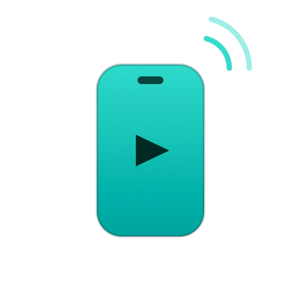
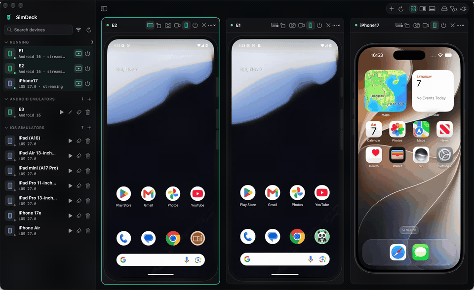
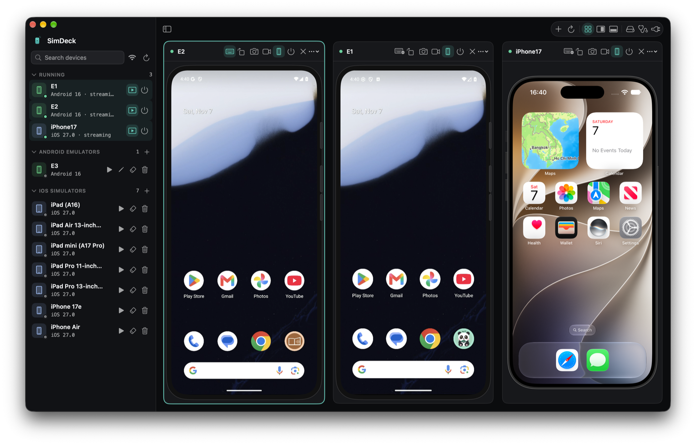
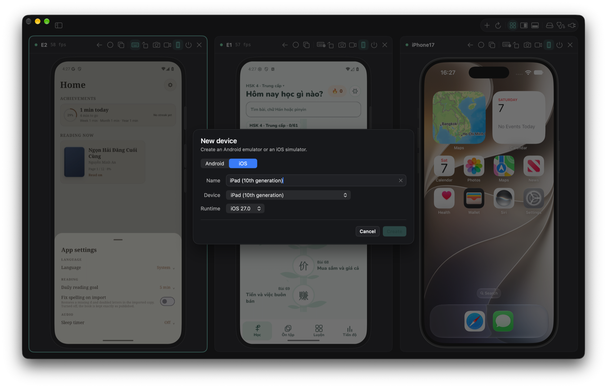
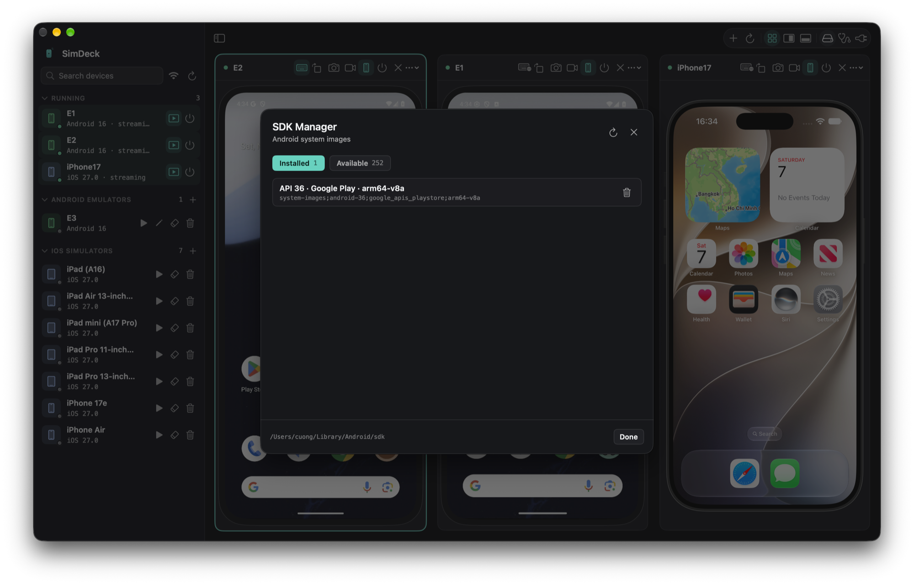

# SimDeck

<p align="center">
  
</p>

<p align="center">
  <strong>Native macOS manager and multi-device streamer for Android emulators and iOS simulators.</strong>
</p>

<p align="center">
  
  
  
  
</p>

---

<p align="center">
  
</p>
<p align="center"><em>Live multi-device streaming and fluid touch interaction across Android 16 and iOS simulators in SimDeck.</em></p>

SimDeck is a native macOS application built with SwiftUI to create, boot, stream, interact with, and delete Android emulators and iOS simulators simultaneously in a single sleek window — all without needing Android Studio.

---

## ✨ Features

- **Multi-Device Unified Streaming**: Stream multiple Android emulators and iOS simulators concurrently in responsive adaptive grid or spotlight layouts.
- **Hardware-Accelerated Decoding**: High-frame-rate Android streaming via a custom embedded `scrcpy-server` protocol client paired with Apple's `VideoToolbox` H.264 hardware decoding.
- **Native iOS Simulator Integration**: Zero-copy framebuffer streaming using private `SimulatorKit` / `CoreSimulator` callbacks with low-latency touch and keyboard input.
- **Realistic Device Frames**: Native Xcode DeviceKit bezels, dynamic island/notch cutouts, and clickable hardware buttons.
- **No Heavy IDE Dependencies**: Create and edit Android Virtual Devices (AVDs) directly through `config.ini` templates — no Java runtime or `avdmanager` required.
- **Built-in Android SDK Manager**: Discover, inspect, and install Android SDK system images directly within the app.
- **AI Agent & MCP Ready**: Serves a loopback Model Context Protocol (MCP) HTTP endpoint (`http://127.0.0.1:8765/mcp`) with 14 tools for automated headless device control (boot, tap, swipe, type, screenshot, terminate).
- **Developer Tools**: Live Logcat viewer with severity filters, ADB Wi-Fi pairing (mDNS / manual code), and one-click screenshots/screen recordings saved to disk.

---

## 📸 Screenshots

| Multi-Device Streaming Dashboard |
|:---:|
|  |

<br/>

| Fast Device Creation | Android SDK Manager |
|:---:|:---:|
|  |  |

---

## 📋 Requirements

- **macOS 14 (Sonoma)** or newer.
- **Xcode** with at least one installed iOS Simulator runtime.
- **Android SDK** with `platform-tools` (`adb`) and `emulator` installed (`ANDROID_HOME`, `ANDROID_SDK_ROOT`, or `~/Library/Android/sdk`).
- *Note:* Java and Android Studio are **not** required.

---

## 🚀 Build & Run

### 1. Generate Xcode Project
SimDeck uses [XcodeGen](https://github.com/yonaskolb/XcodeGen) to maintain clean, declarative project settings:

```bash
cd SimDeck
xcodegen generate
```

### 2. Build Release App

```bash
xcodebuild -project SimDeck.xcodeproj -scheme SimDeck \
  -configuration Release -derivedDataPath build-release build

# Launch the app
open build-release/Build/Products/Release/SimDeck.app
```

> **Note:** SimDeck signs with the `com.apple.security.cs.disable-library-validation` entitlement (`Config/SimDeck.entitlements`) to load Xcode's private `CoreSimulator` and `SimulatorKit` frameworks at runtime for iOS frame capture and input.

---

## 🤖 AI Agents & MCP Server

SimDeck acts as an automated device test harness for AI coding agents (such as Claude, OpenCode, Codex, and custom bots). When running, SimDeck serves an MCP server on `http://127.0.0.1:8765/mcp`.

Add SimDeck to your agent configuration:

```json
{
  "mcp": {
    "simdeck": {
      "type": "remote",
      "url": "http://127.0.0.1:8765/mcp"
    }
  }
}
```

### Supported MCP Tools

- `list_devices`: List all local emulators, simulators, and physical devices.
- `start_device`: Boot a device headless and immediately stream its UI inside SimDeck.
- `stop_device`: Gracefully shut down an emulator or simulator.
- `tap`: Send tap at normalized coordinates `(x, y)` from `0.0` to `1.0`.
- `swipe`: Smooth swipe gesture between `(x1, y1)` and `(x2, y2)`.
- `type_text`: Type text input into the focused element.
- `press_button`: Trigger hardware keys (`home`, `back`, `volume_up`, `volume_down`, `power`).
- `screenshot`: Capture a high-res PNG frame of the device screen.
- `create_avd` / `create_simulator`: Programmatically provision virtual devices.

For shell-only workflows, use the bundled CLI bridge:

```bash
SimDeck/bin/simdeck list
SimDeck/bin/simdeck start android:E1
SimDeck/bin/simdeck swipe ios:EF4916C0-D051-406B-BA3A-B2AA50CA96D1 0.2 0.5 0.8 0.5
SimDeck/bin/simdeck screenshot android:E1
```

---

## 📁 Repository Structure

```
simdeck/
├── SimDeck/              # SwiftUI native application
│   ├── Sources/          # App, UI, Streaming, MCP, Android, Apple
│   ├── Resources/        # Assets, logos, bundled scrcpy-server
│   ├── bin/              # Agent CLI bridge (`simdeck`, `simdeck-mcp`)
│   └── project.yml       # Declarative XcodeGen configuration
├── docs/                 # Documentation & media assets
│   ├── assets/           # Screenshots, demo video, and GIF
│   ├── PROJECT_STATE.md  # Engineering state and verification log
│   └── TASK.md           # Roadmap and ongoing tasks
├── third_party/          # Third-party notices and licenses
└── LICENSE               # MIT License
```

---

## 📄 License

SimDeck is licensed under the **[MIT License](LICENSE)** © 2026 cuongdq88.
