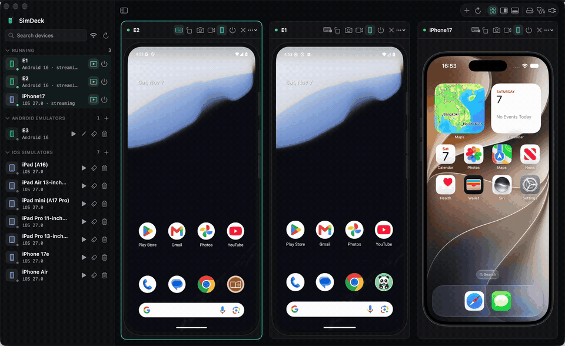
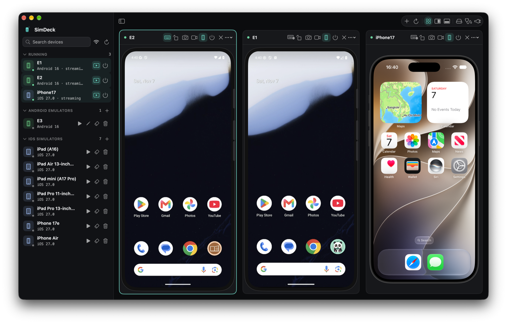
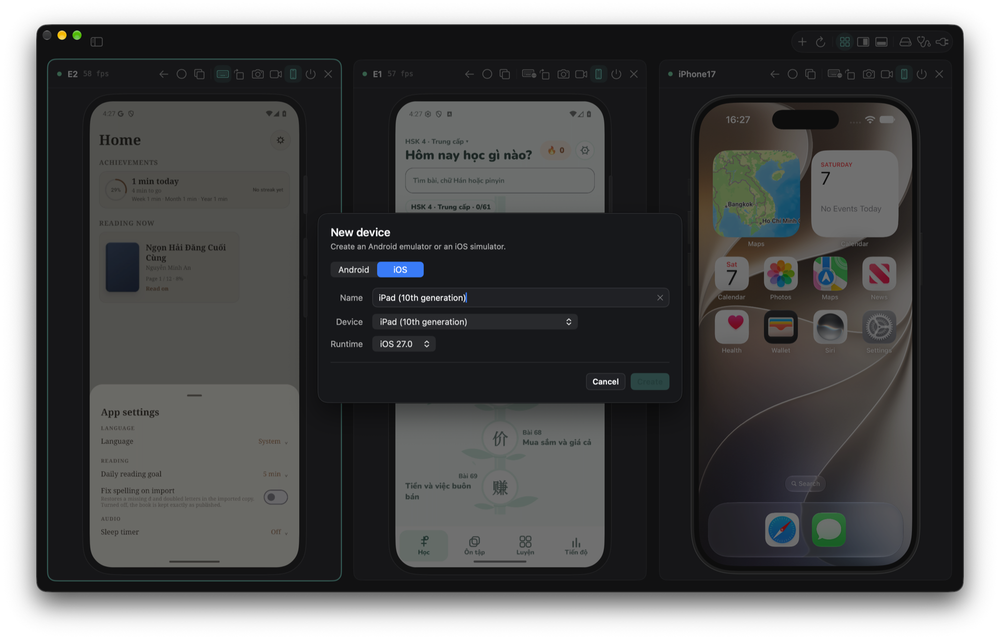
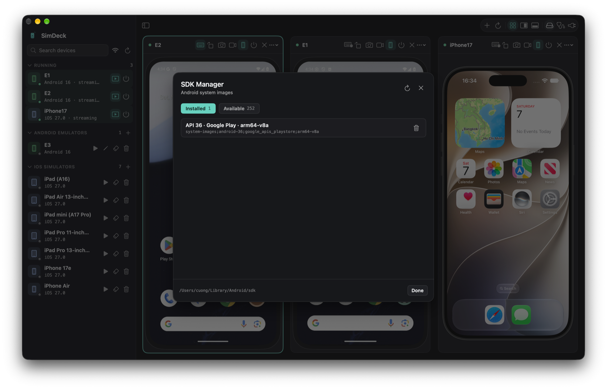

# SimDeck

<p align="center">
  
</p>

<p align="center">
  <strong>Native macOS manager and multi-device streamer for Android emulators and iOS simulators.</strong>
</p>

<p align="center">
  
  
  
  
</p>

---

<p align="center">
  
</p>

- **[SimDeck/README.md](../SimDeck/README.md)** — features, architecture, build, MCP details
- **[SimDeck/AGENT.md](../SimDeck/AGENT.md)** — how agents drive devices through SimDeck
- **[PROJECT_STATE.md](PROJECT_STATE.md)** — verification status and architecture notes
- **[TASK.md](TASK.md)** — roadmap and remaining work

## Screenshots

| Multi-Device Streaming Dashboard |
|:---:|
|  |

| Fast Device Creation | Android SDK Manager |
|:---:|:---:|
|  |  |

## Requirements

macOS 14 or newer, Xcode with a simulator runtime, and an Android SDK with `platform-tools` and `emulator`. Creating AVDs needs no Java.

## Build

```bash
cd SimDeck
xcodegen generate
xcodebuild -project SimDeck.xcodeproj -scheme SimDeck \
  -configuration Release -derivedDataPath build-release build
open build-release/Build/Products/Release/SimDeck.app
```

## Agents

While the app runs it serves MCP on loopback at `http://127.0.0.1:8765/mcp`.
Agents must create and boot devices through it, never by running `emulator`
themselves: `start_device` boots headless and the screen appears inside
SimDeck.

- OpenCode in this repo uses the local bridge `SimDeck/bin/simdeck-mcp`, which
  starts SimDeck on demand.
- Shell-only agents: `SimDeck/bin/simdeck list|start|boot|tap|type|screenshot|stop`.

## Licence

MIT — see [LICENSE](../LICENSE). © 2026 cuongdq88.
